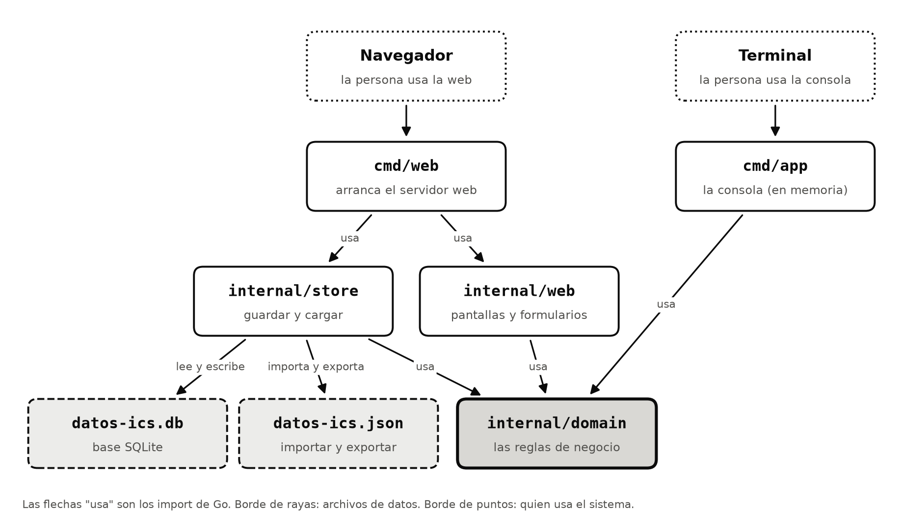
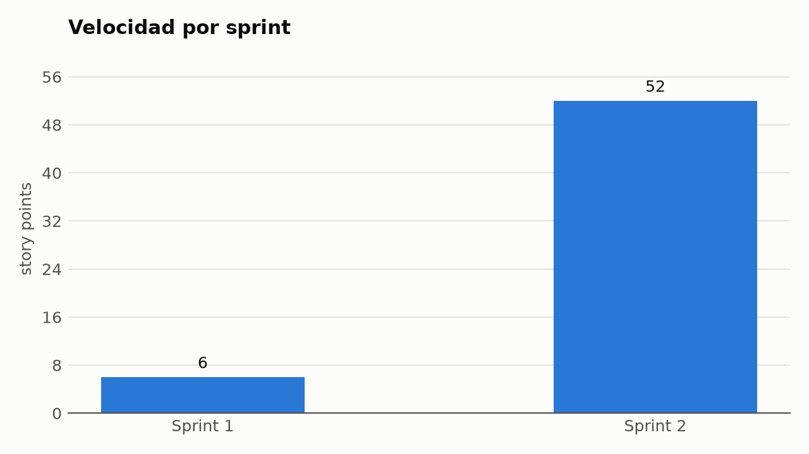
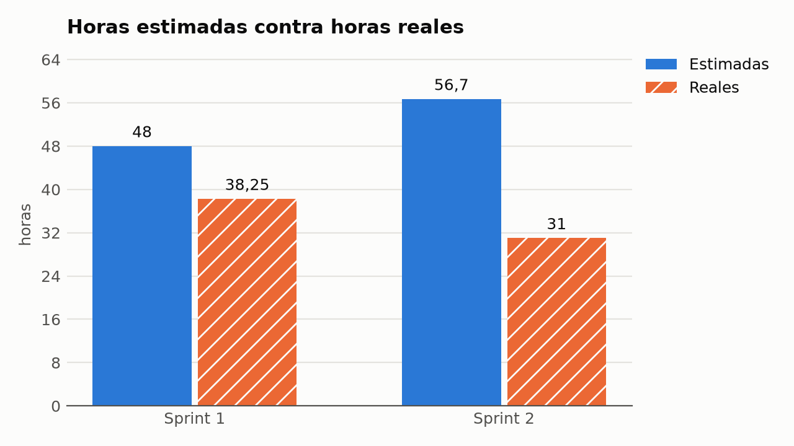
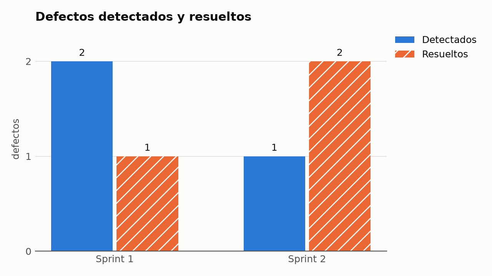
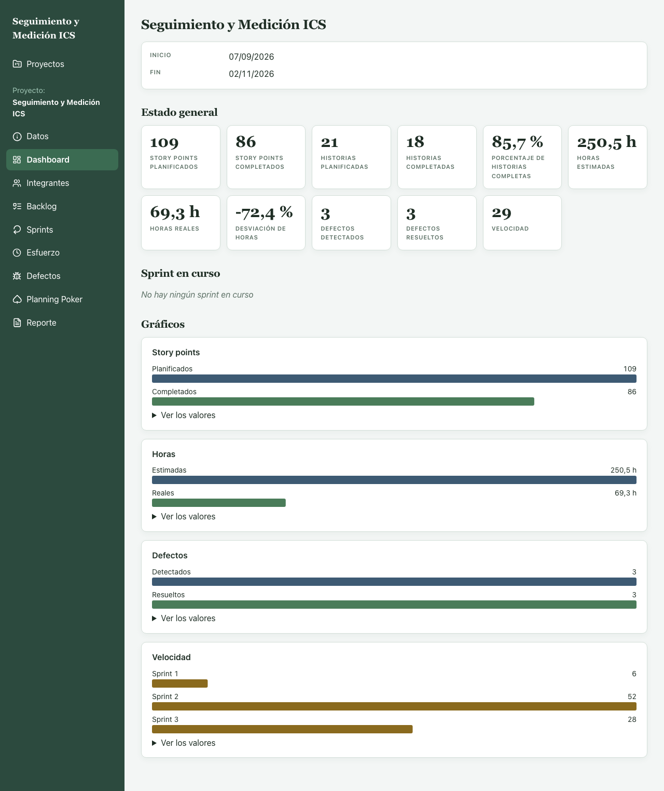

# Informe final del proyecto

Este informe cuenta qué construimos, cómo lo construimos y qué aprendimos midiéndonos, sprint
por sprint. Lo armó Emiliano Sorato (Agile Enabler) con las métricas del repositorio, las actas
y el tablero. Cada sección dice de dónde salen sus datos, para que se pueda comprobar todo.

## Portada

Universidad Tecnológica Nacional, Facultad Regional San Rafael. Ingeniería y Calidad de
Software, 2026. Título: *Seguimiento y medición de proyectos de software*. Integrantes:
Agustín Salinas (legajo 9105), Emiliano Sorato (legajo 8378), Juliana Bustos (legajo 9975) y
Maximiliano Eula (legajo 8665).

## 1. El producto

*Seguimiento y Medición ICS* es una aplicación para estimar, seguir y medir proyectos de
software que se trabajan con Scrum. Se carga un proyecto con sus integrantes, se arma el Product
Backlog, se estiman las historias con Planning Poker, se planifican y se cierran los sprints, se
registran las horas reales y los defectos, y las métricas se ven en un dashboard y en un reporte
que se descarga en PDF. Está pensada para un equipo chico como el nuestro: la demo usa nuestro
propio proyecto, cargado con lo que registramos en el tablero y en las actas.

Cubre todos los requerimientos mínimos de la consigna. Las 21 historias del Product Backlog
están terminadas, con sus 109 story points:

| Requerimiento de la consigna | Historias | Estado |
|---|---|---|
| Gestión de proyectos e integrantes | #3, #4 | Terminadas (Sprint 1) |
| Product Backlog con prioridad, estado, story points y criterios | #6, #7 | Terminadas (Sprint 2) |
| Estado de un proyecto | #5 | Terminada (Sprint 2) |
| Sprints: goal, asignación, cierre y consulta de anteriores | #8, #9, #10, #11 | Terminadas (Sprints 2 y 3) |
| Estimación con story points y Planning Poker: votos ocultos, diferencias, rondas y acuerdo | #12, #13, #73 | Terminadas (Sprints 2 y 3) |
| Esfuerzo real por integrante | #14 | Terminada (Sprint 2) |
| Defectos con severidad, estado, historia y sprints de detección y resolución | #15 | Terminada (Sprint 2) |
| Métricas del proyecto y de cada sprint | #16 | Terminada (Sprint 3) |
| Dashboard con gráficos | #17 | Terminada (Sprint 3) |
| Reporte por proyecto o por sprint | #18 | Terminada (Sprint 3) |
| Reporte exportable a PDF | #19 | Terminada (Sprint 4) |
| Interfaces para usarlo: consola y web | #24, #77, #78 | Terminadas (Sprints 2 y 4) |

Además se agregaron tres trabajos sin story points: guardar los datos en una base de datos
SQLite (#177), el CI/CD que despliega la web en un servidor (#219) y las mejoras visuales para la
demo (#223).

**Cómo se usa.** Hay dos interfaces sobre el mismo núcleo: la consola, para proyectos,
integrantes y backlog, y la web, que hace todo. La web guarda los datos en una base SQLite y
puede importar y exportar un archivo JSON. Cada incremento que llega a `main` se despliega solo
en un servidor, así que se puede abrir desde cualquier lado. El paso a paso está en el
[manual de usuario](manual-de-usuario.md), y cómo se despliega, en
[despliegue.md](despliegue.md).

**Arquitectura.** Todo el núcleo y las reglas de negocio están en Go, en `internal/domain`, sin
dependencias externas. La consola (`cmd/app`) y la web (`internal/web` y `cmd/web`) solo usan
el dominio, y el guardado está aparte, en `internal/store`. El detalle está en la
[documentación técnica](documentacion-tecnica.md).



El diagrama sale de `scripts/diagrama-arquitectura.py`. Las flechas son los import entre
paquetes.

## 2. Cómo trabajamos

**Scrum.** Los Product Architects fueron los profesores. Emiliano Sorato fue el Agile Enabler,
y Agustín Salinas, Juliana Bustos y Maximiliano Eula, los Product Builders; Emiliano también
implementó historias. Hicimos cinco sprints:

| Sprint | Fechas | Objetivo |
|---|---|---|
| 0 | 07/09 → 28/09 | Repositorio, tablero y Product Backlog |
| 1 | 28/09 → 16/10 | MVP: proyectos, integrantes y backlog |
| 2 | 20/10 → 25/10 | Sprints, esfuerzo y defectos, todo operable desde la consola |
| 3 | 26/10 → 28/10 | Que el sistema mida el proyecto y lo muestre: métricas, dashboard y reporte |
| 4 | 29/10 → 30/10 | Cerrar el producto y tener todo lo que se entrega listo para presentar |

Cada sprint tuvo su planning, su review y su retrospectiva, casi todas por escrito en issues y
PRs, porque no coincidíamos en horarios. La daily fue asíncrona, a las 21 h, con una línea de
cada uno. Las actas están en [docs/actas/](actas/), y cada incremento llegó a `main` con su tag.

**Tablero.** Un GitHub Project con siete columnas: Product Backlog, Sprint Backlog,
Especificación SDD, Lista para implementar, En progreso, En review y Hecho. Cada historia tiene
sus story points, su prioridad, su sprint y sus horas estimadas y reales. Las horas estimadas
salen de los story points, a 2,7 h por punto, que es lo que costó un punto en el Sprint 1.

**SDD, BDD y TDD.** Antes de programar una historia se escribe su spec, en
[docs/specs/](specs/), con tres fases: requisitos (con sus reglas de negocio, casos límite,
errores, criterios de aceptación y escenarios Given-When-Then), diseño y tareas. Cada fase pasa
por una puerta que aprueba otro integrante. Después cada tarea es un ciclo de TDD: el test en un
commit, con la salida del RED en el mensaje, y el código que lo hace pasar en el siguiente. No se
aplasta el historial, porque es la evidencia (sección 6).

**Revisión, CI y CD.** Nadie pushea directo: todo entra por pull request, con una revisión
escrita y el CI en verde. El CI corre la coherencia de las specs, `gofmt`, `go vet`, los tests
con su cobertura, los mismos tests en Windows y una prueba de humo de la web armada. El CD, con
cada incremento en `main`, vuelve a probar todo y despliega la web en el servidor.

**Uso de la IA.** La consigna la permite, y el equipo la usó. Emiliano Sorato implementó con
asistencia de IA la #6, la #5, la #14, la #15, la #77, la #10, la #16, la #78, la #177 y la #19:
la IA trabajó bajo su dirección y con su revisión. Maximiliano Eula la usó en la #12, la #24, la
#13 y la #73: la IA proponía el test y el código, y él aprobaba cada paso. Con IA o sin ella,
todo pasó por las mismas puertas, el mismo TDD, la misma revisión y el mismo CI. En las
historias que implementó Emiliano, las horas reales son el tiempo de dirigir y revisar, y por eso
las métricas muestran la desviación con ellas y sin ellas.

## 3. Métricas por sprint

Los números de un sprint cerrado salen de su acta de review, que se escribe al cierre. El
[informe de métricas](informe-de-metricas.md) explica cómo se calcula cada uno.

| Métrica | Sprint 1 | Sprint 2 | Sprint 3 | Sprint 4 |
|---|---|---|---|---|
| Fechas | 28/09 → 16/10 | 20/10 → 25/10 | 26/10 → 28/10 | 29/10 → 30/10 |
| SP planificados | 16 | 31 (44 con la #77) | 41 | 18 |
| SP completados (velocidad) | **6** | **52** (44 + 8 adelantados) | **33** (28 + 5 adelantados) | **18** |
| Historias completadas | 2 de 5 (40%) | 10 de 10 (100%) | 5 de 6 (83%) | 2 de 2 (100%) |
| Horas estimadas | 48 | 56,7 | 110,7 | 48,6 |
| Horas reales trabajadas | 38,25 | 31 | 47 | 3,5 |
| Desviación de las historias terminadas | −11% | −52% (−36% sin la #5, la #14 y la #15) | −51% (−21% sin la #10 y la #16) | −93% (las dos con asistencia de IA) |
| Horas por story point completado | 2,7 | 1,0 (1,8 sin la #5, la #14 y la #15) | 1,3 | 0,2 |
| Defectos detectados / resueltos | 2 / 1 | 1 / 2 | 6 / 6 | 1 / 1 |

**Velocidad del proyecto: 27 story points por sprint** (el promedio de 6, 52, 33 y 18).

**Sprint 0 — preparación** ([acta](actas/sprint-0-cierre.md)). No tuvo story points: era
dejar listos el repositorio, el tablero y el Product Backlog. Se cumplió el objetivo: el
repositorio y el Project públicos, el README, los colaboradores, las reglas de trabajo, el CI
y un Product Backlog de 17 historias (issues #3 a #19), sacado de los requerimientos mínimos
de la consigna. Quedaron dos cosas mal: el backlog terminó sin estimar, y la entrega del
campus se subió fuera de término.

**Sprint 1 — MVP** ([planning](actas/sprint-1-planning.md),
[review](actas/sprint-1-review.md), [retro](actas/sprint-1-retrospectiva.md)). Se
comprometieron 16 SP y se terminaron 6: la #3 y la #4. La #12 y la #24 volvieron al backlog.
La #6 se mergeó el 19/10, después del cierre, y por eso cuenta en el Sprint 2. La desviación
total fue de −20% (48 h estimadas contra 38,25 trabajadas) y la de las terminadas, de −11%
(18 contra 16). De ahí sale la conversión de **2,7 horas por story point** que se usó para
estimar los sprints siguientes.

**Sprint 2 — interfaz usable** ([planning](actas/sprint-2-planning.md),
[review](actas/sprint-2-review.md), [retro](actas/sprint-2-retrospectiva.md)). Se
terminaron las 9 historias comprometidas (31 SP) y además la #13, adelantada desde el Sprint 3
(8 SP): al cierre, la velocidad fue de 39. La #77, la base de la web, también se terminó en el
sprint, pero sin story points. El 26/10 el equipo la estimó en 13 y sumó al sprint, que quedó
con 44 SP terminados y velocidad 52. Las horas trabajadas en el sprint fueron 31: Agustín
Salinas 20, Maximiliano Eula 8, Emiliano Sorato 3 y Juliana Bustos 0, según el tablero.
Juliana Bustos anotó además 14 horas propias que no están en el tablero (la spec de la #17,
revisiones y gestión). La #5, la #14 y la #15 las implementó Emiliano Sorato con asistencia de
IA, y por eso se muestra también la desviación sin esas tres. La #77 tampoco entra en la
desviación, porque no tiene horas estimadas: se estimó cuando ya estaba terminada.

**Sprint 3 — funcionalidad y calidad** ([planning](actas/sprint-3-planning.md),
[review](actas/sprint-3-review.md), [retro](actas/sprint-3-retrospectiva.md)). Se
comprometieron 41 SP y se terminaron 28: la #10, la #16, la #11, la #17 y la #18. La #17 y la
#18 entraron a `dev` el 29/10, un día después del fin del sprint, y cuentan en el 3 porque
estaban comprometidas ahí y la review se hizo después. La #78 llegó con 22 de sus 24 tareas:
le faltaban el reporte y su PDF en la web, que dependían de la #18 y la #19, así que volvió al
Product Backlog sin sumar. Con los 5 SP de la #73, adelantada, la velocidad fue de 33. Las
horas trabajadas fueron 47, y las terminadas dan −51% (−21% sin la #10 y la #16, hechas con
asistencia de IA). La prueba exploratoria de la web del 26/10 encontró cuatro defectos, y los
seis defectos del sprint se resolvieron antes del cierre.

**Sprint 4 — cierre** ([planning](actas/sprint-4-planning.md),
[review](actas/sprint-4-review.md), [retro](actas/sprint-4-retrospectiva.md)). Iba a durar un
día, el 29/10, y siguió el 30/10 para terminar la #78 y la #19. Se comprometieron 18 SP, los
de esas dos, y se terminaron los 18: la #19 conectó el PDF con el reporte de la #18 (PR #222),
y la #78 sumó el reporte y su descarga en la web (PR #224). Se resolvió el único defecto del
sprint, el #220. También se terminaron el CI/CD con el deploy (#219) y las mejoras visuales
para la demo (#223), sin story points. Las dos historias las implementó Emiliano Sorato con
asistencia de IA, así que sus horas son su tiempo de dirigir y revisar: 1 h la #19 y 2,5 h la
#78 (1,5 del Sprint 3 y 1 del 4), contra 48,6 estimadas. Por eso la desviación da −93% y el
punto sale a 0,2 h, y el sprint no sirve para comparar el costo de un punto con los demás. Las
horas trabajadas en el sprint fueron 3,5: la #19, lo nuevo de la #78 y la #219.

**Historias adelantadas, agregadas y estimadas después.**

- **Adelantadas.** Desde el 21/10, quien termina lo suyo adelanta su próxima historia (decisión
  11 del [plan](plan-final-al-2-de-noviembre.md)). Una adelantada no suma a lo comprometido; si
  se termina, suma a la velocidad, aparte. Fueron la #13 en el Sprint 2 y la #73 en el 3.
- **Agregadas durante el sprint.** La #177 (la base de datos) entró al Sprint 3 ya empezado, y
  la #219 (el CI/CD) y la #223 (las mejoras visuales), al Sprint 4. No tienen story points:
  sus horas suman al total del sprint, pero no a la velocidad ni a la desviación.
- **Estimadas después.** La #77 y la #78, las de la web, entraron sin story points. El equipo
  las estimó el 26/10 en la ronda 2 del Planning Poker: 13 y 13, con los cuatro de acuerdo. La
  #77 ya estaba terminada y suma al Sprint 2. La #78 entró en el compromiso del Sprint 3 y, como
  no se terminó, sumó en el Sprint 4.

## 4. Gráficos

Los tres gráficos salen de la tabla de la sección 3, con `scripts/graficos-informe.py`.







El dashboard de la aplicación muestra lo mismo con los datos de demo, que son nuestro proyecto
al cierre del Sprint 2 con el Sprint 3 cerrado en vivo, como en el
[guion de la demo](demo/guion-de-demo.md):



## 5. Pruebas y cobertura

Medido con `go test -cover ./...` sobre `dev` al cierre de cada sprint.

| Paquete | Qué tiene | Sprint 1 (`4481d1c`) | Sprint 2 (`b45cbe6`) | Sprint 3 (`5d1d556`) | Sprint 4 (`89e4afd`) |
|---|---|---|---|---|---|
| `internal/domain` | el núcleo y las reglas de negocio | **100%** | **100%** | **100%** | **100%** |
| `internal/store` | el guardado: en archivo, y desde la #177 en la base de datos | — | 96,0% | 87,1% | 87,1% |
| `internal/web` | las pantallas de la web | — | 93,8% | 94,1% | 94,4% |
| `cmd/app` | la consola | 0% (sin lógica todavía) | 96,2% | 96,2% | 96,2% |
| `cmd/web` | el arranque de la web | — | 56,2% | 91,1% | 91,1% |
| **Total** | | **99,2%** | **96,0%** | **95,7%** | **95,8%** |
| Tests | | 52 | 263 | 420 | 426 |

- El dominio, donde están todas las reglas de negocio, estuvo al 100% en todos los cierres.
- La cobertura total baja en el Sprint 3 por `internal/store`: la #177 cambió el guardado en
  archivo por la base de datos, y esa parte nueva queda en 87,1%.
- Al cierre son 426 tests y 607 subtests, que salen de los tests con tabla, y pasan todos, en
  Linux y en Windows.
- La prueba de humo del CI abre la web compilada con los datos de demo y pide sus páginas
  principales, también el reporte y su PDF.
- De los escenarios BDD, todos los de las historias tienen su test (ver la sección 6 y la
  [trazabilidad](trazabilidad.md)).

## 6. Evidencia de TDD

La regla del proyecto es que el test va en un commit (`test:`, con la salida del RED en el
mensaje) y el código que lo hace pasar, en el siguiente (`feat:`). No se aplasta la historia,
así que el ciclo queda en el historial de `dev`. `scripts/trazabilidad.sh` lee ese historial y
le pone a cada test una marca:

| Qué muestra el historial | Sprint 2 (`4f7644b`) | Sprint 3 (`5d1d556`) | Sprint 4 (`89e4afd`) |
|---|---|---|---|
| Ciclo completo: el test en un commit y el código que lo hace pasar en el siguiente | 250 | 321 | 327 |
| Ciclo completo, con el test trayendo lo justo para compilar (una firma o una constante) | 3 | 3 | 3 |
| Sin RED: el test pasó con el código que ya estaba, y el commit lo dice | 44 | 69 | 69 |
| Sin GREEN: después del test no hay un commit de código | 13 | 13 | 13 |
| Test y código en el mismo commit (desvío del TDD) | 1 | 1 | 1 |

El único desvío es `0d22bc7`, de la #6, en el Sprint 1. Los "sin RED" son casos que una tarea
anterior ya resolvía. Desde el 20/10 se dejan dichos en el asunto del commit, para que no
parezca que el test se escribió después.

Los 13 "sin GREEN" no son tests escritos después del código. Son 13 tests del Sprint 1, del 9
y el 13/10: 5 de la #4 y 8 de la #6. Uno por uno, cada test pasa en su propio commit con código
que ya había escrito un par RED → GREEN anterior de la misma historia (por ejemplo, el "no se
encontró" o la copia de la lista). Son "sin RED" que no quedaron marcados, porque esa costumbre
empezó el 20/10.

**Un par de ejemplo**, de la #13 (PR #141), el mismo de la sección 7:

- RED: `ba90caa` — *test: votar registra quién votó sin dejar ver los votos (historia 13, tarea
  5)*. Agrega el test a `internal/domain/voting_round_test.go` y trae en el mensaje la salida
  del compilador: `round.Vote undefined` y `undefined: ErrVotesHidden`.
- GREEN: `6a78fd1` — *feat: votar sin que se pueda leer ningún voto antes de revelar (historia
  13, tarea 5)*.

Del cierre del Sprint 3 al final se sumaron 6 ciclos completos, los de la #19, la #78 y el
defecto #220, y ningún desvío nuevo: los 13 "sin GREEN" y el test con el código en el mismo
commit son los mismos del Sprint 1.

## 7. Trazabilidad de punta a punta: la #13 *Votar en secreto en una ronda de Planning Poker*

Es el Planning Poker con votos ocultos que pide la consigna, y la hizo Maximiliano Eula. De sus
16 escenarios, los 16 tienen el ciclo RED → GREEN completo, y sus 13 commits de test traen en el
mensaje la salida del RED. El recorrido de todas las historias está en
[docs/trazabilidad.md](trazabilidad.md).

1. **Historia de usuario** — [issue #13](https://github.com/emisorato1/seguimiento-medicion-ics/issues/13):
   *Como integrante del equipo quiero votar la estimación de una historia sin ver lo que votaron
   los demás, para que nadie se deje influir y la estimación salga del criterio de cada uno.*
   Tiene 8 SP. Se adelantó desde el Sprint 3 y se terminó en el Sprint 2 (PR #141, 23/10), con
   la revisión de Juliana Bustos.
2. **Especificación SDD** — [docs/specs/sprint-3/13-votar-en-secreto.md](specs/sprint-3/13-votar-en-secreto.md):
   objetivo, entradas, salidas, reglas de negocio (desde la RN-1), casos límite y condiciones de
   error. Agustín Salinas aprobó sus tres puertas el 21/10, en el
   [PR #115](https://github.com/emisorato1/seguimiento-medicion-ics/pull/115#issuecomment-6328013297).
3. **Criterio de aceptación** — de la issue y de la spec: *"Mientras la ronda no esté revelada,
   ningún voto se puede leer desde afuera, ni siquiera el propio. Solo se sabe quién votó y
   quién falta."*
4. **Escenario BDD** — en la [misma spec](specs/sprint-3/13-votar-en-secreto.md?plain=1#L188):

   ```gherkin
   Escenario: Votar registra quien voto sin dejar ver los votos, ni siquiera el propio
     Dado una ronda sin revelar con "Agustin Salinas", "Juliana Bustos" y "Maximiliano Eula"
     Y "Agustin Salinas" voto 3 y "Juliana Bustos" voto 8
     Cuando "Juliana Bustos" pide ver los votos de la ronda
     Entonces se informa que los votos estan ocultos hasta que se revele la ronda
     Y solo se sabe que votaron "Agustin Salinas" y "Juliana Bustos" y que falta "Maximiliano Eula"
   ```

5. **Test en Go** — `TestVotarRegistraQuienVotoSinDejarVerLosVotosNiSiquieraElPropio`, en
   [internal/domain/voting_round_test.go:161](../internal/domain/voting_round_test.go#L161). Arriba
   lleva los comentarios `// Escenario:` con el título del escenario y `// Cubre: RN-8, RN-12,
   RN-13`. Entró en el commit RED `ba90caa` (22/10), que trae en el mensaje la salida del
   compilador: `round.Vote undefined`, `round.Votes undefined` y `undefined: ErrVotesHidden`.
6. **Código Go** — `(*VotingRound).Vote`, en
   [internal/domain/voting_round.go:101](../internal/domain/voting_round.go#L101), y
   `(*VotingRound).Votes`, en [voting_round.go:135](../internal/domain/voting_round.go#L135), que
   devuelve `ErrVotesHidden` mientras la ronda no se revela. Entraron en el commit GREEN
   `6a78fd1` (22/10) y llegaron a `dev` con el PR #141.

**Un detalle para contar en la defensa.** Además de `Votes()`, la ronda tiene
`(VotingRound).Format`, en [voting_round.go:56](../internal/domain/voting_round.go#L56). Sin eso,
imprimir la ronda con `%#v`, la forma de depuración de Go, mostraba los votos ocultos.
Maximiliano Eula lo nombra en la [retro del Sprint 2](actas/sprint-2-retrospectiva.md) entre los
problemas que aparecieron en las revisiones antes de llegar a `dev`. Tiene su propio par RED →
GREEN (tarea 12, commit GREEN `ad93071`).

## 8. Retrospectivas

Lo que se acordó en cada retro y si se cumplió en el sprint siguiente. Sale de las actas
`sprint-N-retrospectiva.md`.

| Retro | Acuerdo | ¿Se cumplió? |
|---|---|---|
| Sprint 0 | Ningún PR se mergea sin la aprobación de otro integrante, sin bypass de administrador | No: en el Sprint 1 hubo cuatro PRs con bypass |
| Sprint 0 | Cada integrante lleva al menos una historia de punta a punta | En parte |
| Sprint 1 | Cero bypass de administrador, ni hacia `dev` ni hacia `main` | Sí hasta la entrega. La única excepción fue el PR #232, el incremento final: el 31/10 no había nadie disponible para aprobarlo y lo mergeó Emiliano Sorato con permisos de administrador |
| Sprint 1 | Un PR con cambios pedidos no se mergea hasta que se respondan | Sí, según los cuatro |
| Sprint 1 | Un PR abierto antes de las 18 h se revisa ese mismo día | En parte |
| Sprint 2 | Una franja fija por día para revisar los PRs asignados | No se midió |
| Sprint 2 | Pedir revisor apenas se abre el PR | No se midió |
| Sprint 2 | Seguir adelantando historias, con sus tres puertas aprobadas y lo que necesitan en `dev` | Sí: la #73 |
| Sprint 3 | ESTADO.md lo regenera una sola persona, una vez por día | En parte: el 30/10 se regeneró dos veces |
| Sprint 3 | No se mergea un PR con cambios pedidos sin responder | Sí |
| Sprint 3 | Se mergea apenas el PR tiene su revisión y el CI en verde | Sí |
| Sprint 3 | Un test que pasa sin RED se revisa contra los otros lugares donde se aplica la misma regla | Sí: en la tarea 24 de la #78, que pasó sin RED, se comprobó que el test fallaba rompiendo la plantilla |

## 9. Conclusiones

**Lo que más nos sirvió fue escribir la spec antes y pasarla por las puertas.** Con el contrato
del dominio acordado, cada uno pudo avanzar sin esperar al otro, y el Sprint 2 ya se hizo con
las specs escritas de antemano. Por eso la velocidad pasó de 6 en el Sprint 1 a 52 en el 2, y
33 y 18 en los dos últimos, que fueron cortos.

**En horas estimábamos mal.** Con 2,7 h por punto, que fue lo que costó el Sprint 1, quedamos
siempre muy por encima de lo real: −52% en el Sprint 2 y −51% en el 3. Una parte se explica por
las historias hechas con asistencia de IA, donde las horas son el tiempo de dirigir y revisar,
pero aun sin ellas la desviación fue de −36% y −21%. Los story points fueron más estables que
las horas. Si lo hiciéramos de nuevo, mediríamos aparte las horas de lo hecho con IA desde el
Sprint 1, como dijeron Maximiliano Eula y Juliana Bustos en la retro final, y cargaríamos las
horas reales apenas se termina cada historia.

**La calidad vino de los tests y de revisar con los tests corridos.** El dominio quedó al 100%
de cobertura en todos los cierres, y todos los escenarios de las historias tienen su test. Casi
todos los defectos los encontramos revisando PRs o en la prueba exploratoria del 26/10, no
usando el sistema.

**Lo que costó más de lo pensado** fue la web. Mostrar una regla de negocio en una pantalla
accesible y que se vea bien en el celular llevó más trabajo que la regla misma, y la #78
terminó siendo la historia más larga del proyecto. También los archivos que tocábamos todos
(ESTADO.md, el índice de specs y el contrato del dominio), que chocaban seguido al cierre de
cada sprint.

**Qué haríamos distinto:** arrancar desde el Sprint 1 con el contrato del dominio y las specs
por adelantado, como dijo Agustín Salinas, para no esperar puertas ni depender de que otro
termine. También empezar con la base de datos y la web desde el principio, en vez de sumarlas
con el proyecto avanzado, y armar antes el CD con el deploy, para mostrar cada incremento
funcionando.

## Anexos

- [Repositorio](https://github.com/emisorato1/seguimiento-medicion-ics) y
  [tablero](https://github.com/users/emisorato1/projects/3)
- [Actas](actas/) de cada planning, review y retrospectiva
- [Especificaciones](specs/README.md) y [trazabilidad](trazabilidad.md)
- [Informe de métricas y cobertura](informe-de-metricas.md)
- [Manual de usuario](manual-de-usuario.md) y [documentación técnica](documentacion-tecnica.md)
- [Integración y despliegue continuos](despliegue.md)
- [Guion de la demo](demo/guion-de-demo.md) y [guía para la defensa](guia-de-defensa.md)
