# Manual de usuario

Guía breve para usar el sistema de seguimiento y medición de proyectos. Crece a medida que
se terminan las historias: hoy cubre la **interfaz web** (historia #77) y la **interfaz de
consola** (historia #24), y en la web también los sprints, el esfuerzo, los defectos y el
Planning Poker (historia #78). El reporte y su PDF se suman cuando estén terminados.

Las dos interfaces hacen lo mismo con los proyectos, los integrantes y el backlog; lo demás
se hace solo desde la web. **No comparten los datos**: la web los guarda en un archivo y los
encuentra al volver a abrirla; la consola los pierde al cerrarse.

**Antes de empezar:** para abrir cualquiera de las dos hace falta tener Go instalado. Los
proyectos, las historias, los sprints y los defectos se reconocen por su **número**, que el
sistema les da al crearlos y empieza en 1: la web lo muestra en la columna «Número» y la
consola lo pide como «identificador». Es el mismo dato.

## Desde el navegador

### Abrir el sistema

En una terminal, dentro de la carpeta del proyecto, escribí:

```bash
go run ./cmd/web
```

El sistema muestra la dirección donde se abre, **http://127.0.0.1:8080**. Copiala en el
navegador. No hace falta internet. Para cerrarlo, volvé a la terminal y apretá `Ctrl+C`.

- **Si dice que el puerto ya lo está usando otro programa**, abrilo en otro puerto con
  `go run ./cmd/web -puerto 8081` y usá la dirección que muestra.
- **Los datos se guardan solos** después de cada cambio, en la base de datos `datos-ics.db`
  de esa carpeta. Al volver a abrir el sistema está todo como lo dejaste. Un cambio queda
  guardado entero o no queda: nunca a medias. Para usar otra base, por ejemplo una para una
  demo: `go run ./cmd/web -datos demo.db`.
- **Si en la carpeta está el `datos-ics.json`** donde guardaba los datos la versión anterior,
  y la base está vacía, el sistema lo importa solo la primera vez que se abre, lo renombra a
  `datos-ics.json.importado` y lo avisa. Así no se vuelve a importar.
- **Para traer datos de un archivo**, por ejemplo los de una demo, a una base nueva:
  `go run ./cmd/web -datos demo.db -importar datos-demo.json`. Solo se importa a una base
  vacía: si ya tiene datos, el sistema avisa y no cambia nada.
- **Para llevarse todos los datos a un archivo**, como copia o para otra computadora:
  `go run ./cmd/web -exportar copia.json`. Escribe el archivo y termina, sin abrir la página.
- **Si la base de datos está dañada**, el sistema avisa y no arranca, y no la toca. Se puede
  arrancar con otra base usando `-datos`, e importar ahí una copia exportada.
- **Para abrirlo desde un celular** en la misma red, agregá `-red`: el sistema muestra
  también la dirección para el celular. No tiene usuarios ni contraseñas, así que usalo solo
  en una red de confianza.

### Cómo se usa

- **La barra de arriba** lleva siempre a la lista de proyectos. Dentro de un proyecto,
  muestra su nombre y sus partes: **Datos**, **Integrantes**, **Backlog**, **Sprints**,
  **Esfuerzo**, **Defectos** y **Planning Poker**.
- **Cada cambio se confirma** con un mensaje en verde arriba de la página. Recargar la página
  no repite el cambio.
- **Si algo está mal**, el formulario vuelve con lo que escribiste y el motivo en rojo,
  debajo del campo que hay que corregir. Corregilo y volvé a enviar.
- **Antes de lo que no se deshace** (quitar algo, cerrar un sprint o resolver un defecto),
  el sistema pregunta. Con «Cancelar» no cambia nada.
- **Lo que se elige de una lista** (un integrante, una historia, un sprint, la severidad)
  empieza sin nada elegido: hay que elegirlo a propósito.
- Todo se puede hacer **con el teclado**: Tab para pasar de un campo a otro y Enter para
  enviar. En Safari, para pasar también por los enlaces, se usa Option+Tab.

### Proyectos

La primera pantalla es la lista de proyectos. Con **Nuevo proyecto** (o, la primera vez,
**Crear el primer proyecto**) se carga uno: nombre y fecha de inicio son obligatorios; la
descripción y la fecha de fin, no.

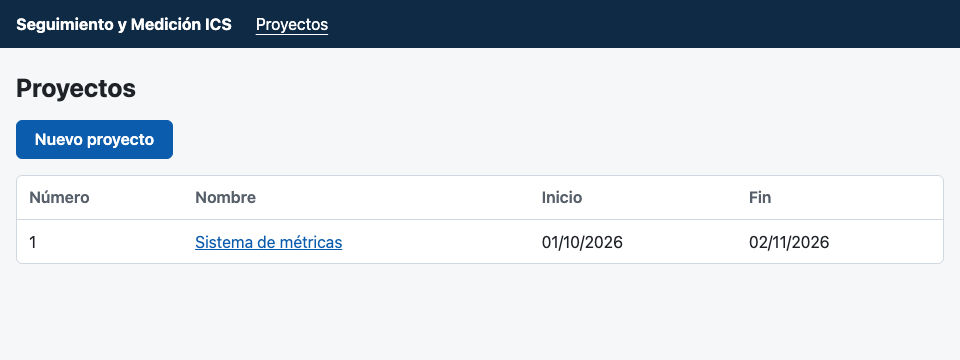

Si falta un dato o las fechas no cierran (la de fin antes que la de inicio), el formulario
lo marca en el campo:

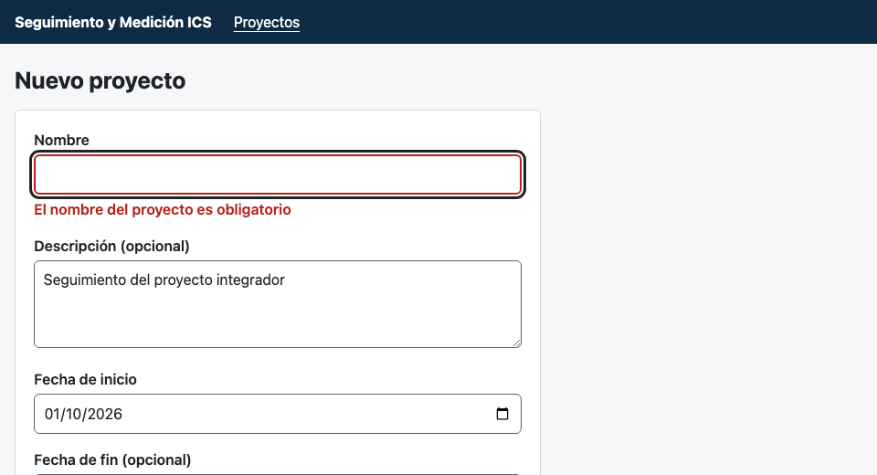

Al hacer clic en el nombre de un proyecto se ven sus datos y un resumen: cuántas historias
tiene, cuántas están completadas y cuántas pendientes, y qué sprint está en curso. Con
**Modificar proyecto** se cambian los datos. Si borrás la descripción o la fecha de fin, el
proyecto queda sin ellas.

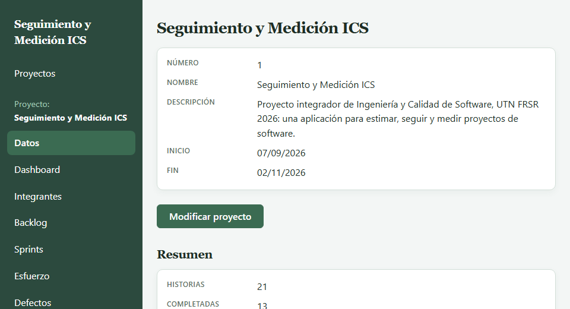

### Integrantes

En **Integrantes** se ve quién trabaja en el proyecto y con qué rol. Con **Agregar
integrante** se carga uno, con su nombre y apellido y su rol, elegido de la lista. Un
proyecto tiene un solo Agile Enabler, y no se puede cargar dos veces a la misma persona: si
pasa, el formulario lo avisa en el campo.

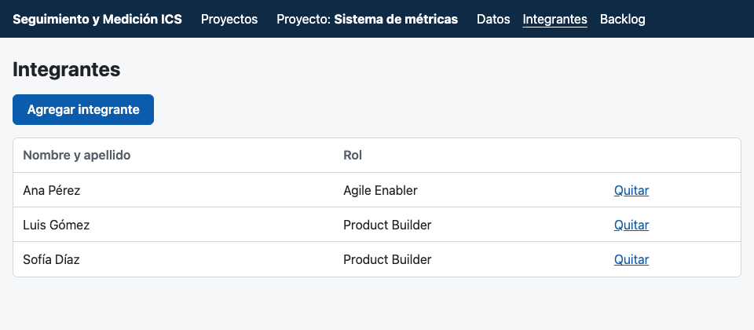

Con **Quitar** se saca a un integrante. Antes, el sistema pide confirmarlo:

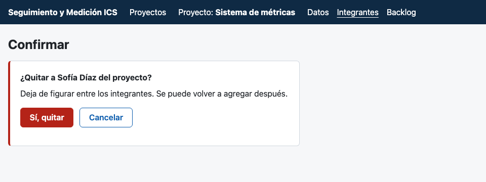

### Backlog e historias

En **Backlog** están las historias del proyecto, con su prioridad, su estado y sus story
points. Con **Cargar historia** se agrega una: título, descripción, prioridad y al menos un
criterio de aceptación, uno por renglón. La historia empieza Pendiente y sin estimar.

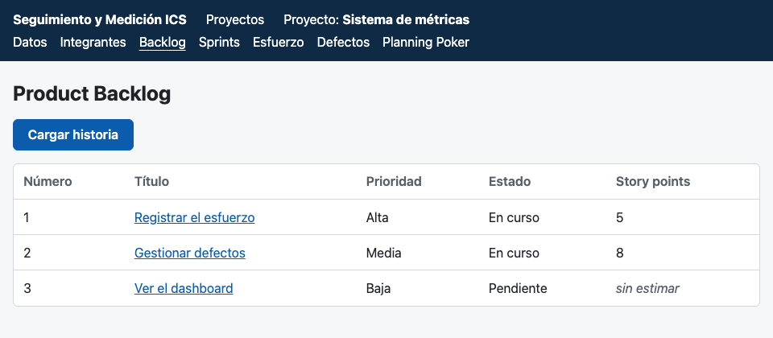

Al hacer clic en una historia se ven todos sus datos. Desde ahí:

- **Modificar historia** cambia el título, la descripción, la prioridad o los criterios.
- **Estimar** (o **Reestimar**) le asigna story points, elegidos de la escala 1, 2, 3, 5, 8,
  13 y 21.
- **Quitar estimación** la deja sin estimar, después de confirmarlo.
- **Cargar horas estimadas** le pone las horas que se calcula que va a llevar. Se pueden
  escribir con coma o con punto, por ejemplo `6,5`.

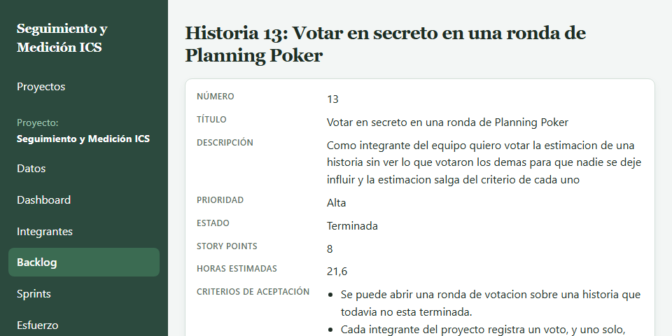

### Sprints

En **Sprints** están todos los sprints del proyecto, con su Sprint Goal, sus fechas, su
estado y, si ya se cerró, la fecha de cierre. Con **Nuevo sprint** se crea uno: el Sprint
Goal y las fechas de inicio y de fin. Hay un solo sprint abierto por vez.

Al hacer clic en el sprint abierto se ve su Sprint Backlog. Desde ahí:

- **Asignar al sprint** suma una historia del backlog, elegida de la lista. Solo se pueden
  asignar historias estimadas: si no, el sistema lo avisa junto a la lista.
- **Quitar** saca una historia del sprint, después de confirmarlo. La historia vuelve a
  quedar Pendiente.

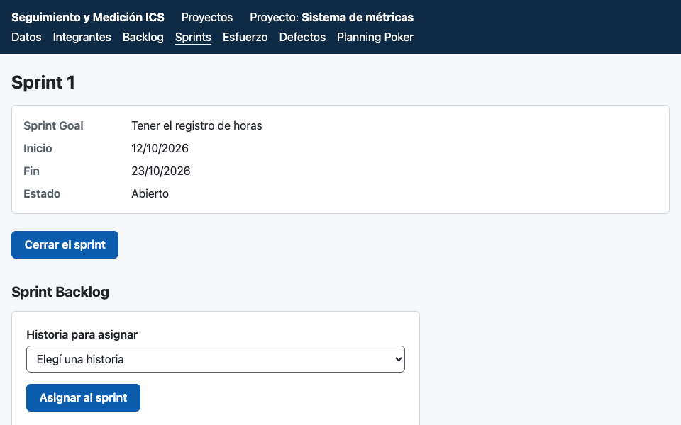

**Cerrar el sprint** pide la fecha de cierre (propone la de hoy) y que marques las historias
que se completaron. Antes de cerrarlo, el sistema muestra cuáles quedan completadas y
cuáles vuelven al Product Backlog, y pide confirmarlo: un sprint cerrado no se vuelve a
abrir.

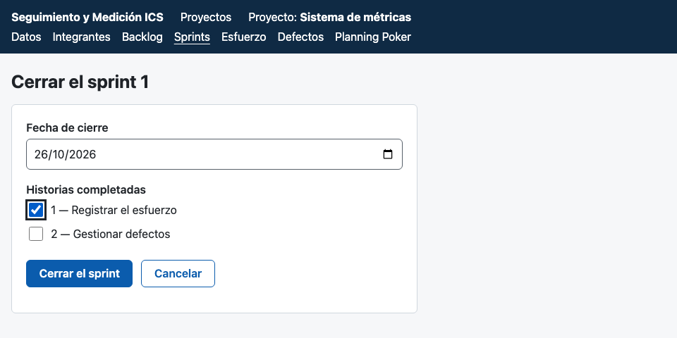

Un sprint cerrado se sigue pudiendo consultar: muestra su fecha de cierre y, por cada
historia, los story points que tenía al cerrarse y si se completó.

### Esfuerzo

En **Esfuerzo** se ven las horas trabajadas: el total por historia, el total por integrante
y todos los registros. Con **Registrar horas** se carga uno: quién trabajó, en qué historia,
qué día (propone el de hoy), cuántas horas y qué hizo. Las horas aceptan decimales (`2,5`).
No se pueden cargar horas de un día que todavía no pasó. Si el proyecto no tiene
integrantes, el formulario lo dice y ofrece agregar el primero.

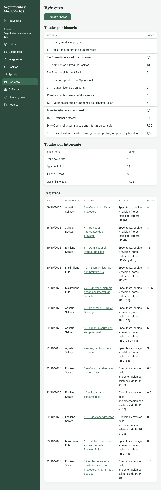

### Defectos

En **Defectos** están los errores encontrados, con su severidad, su estado, la historia
donde apareció y en qué sprint se detectó y se resolvió. Con **Nuevo defecto** se carga uno:
título, descripción, severidad (Crítica, Mayor o Menor), la historia y el sprint en que se
detectó. Empieza Abierto. Si el proyecto no tiene sprints, el formulario lo dice y ofrece
crear el primero.

Arriba de la lista se puede **filtrar por estado** o **por severidad**, uno por vez. Con
**Ver todos los defectos** se saca el filtro.

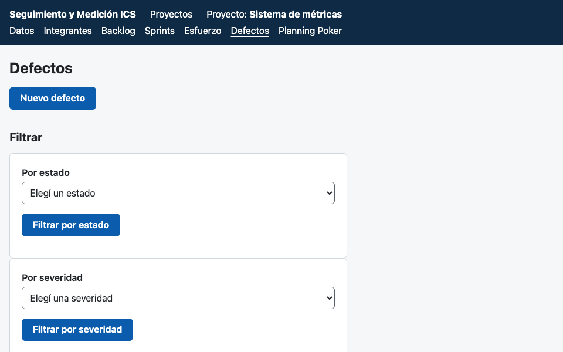

Al hacer clic en un defecto se ven sus datos. Desde ahí se lo pasa entre **Abierto** y **En
curso**, o se lo **resuelve** eligiendo en qué sprint se resolvió, que no puede ser
anterior al de detección. Resolverlo pide confirmación, y un defecto resuelto ya no cambia.

### Planning Poker

En **Planning Poker** se elige una historia y se abre una ronda para estimarla. Cada
integrante elige su nombre de la lista de los que faltan y vota sus story points. **Nadie ve
ningún voto hasta revelar la ronda**, ni siquiera quien lo dio: la página muestra solo
quiénes votaron y quiénes faltan.

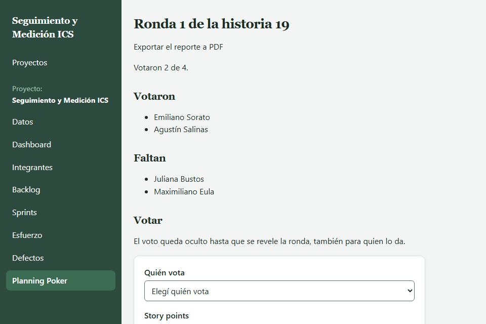

Cuando votaron todos, **Revelar la ronda** muestra cada voto y si hay diferencias, con el
voto más bajo y el más alto y quiénes los dieron. Desde ahí se puede:

- **Acordar** la estimación, que queda como los story points de la historia.
- **Abrir una ronda nueva**, para volver a votar después de conversar las diferencias.

Una ronda ya acordada no ofrece abrir otra. Si querés volver a estimar esa historia, abrí la
ronda nueva desde **Planning Poker**, eligiendo la historia otra vez.

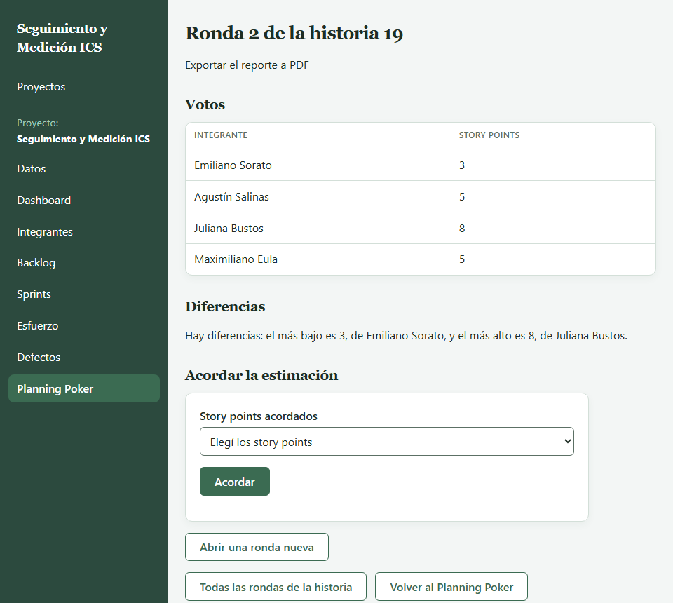

Con **Todas las rondas de la historia** se ven las rondas anteriores y lo que se acordó en
cada una.

### Si algo sale mal

| Lo que ves | Qué hacer |
|---|---|
| Un mensaje en rojo debajo de un campo | corregir ese campo y volver a enviar |
| «no se encontró el proyecto» (o la historia, el sprint, el defecto o la ronda) | volver con el botón y elegirlo de la lista |
| «ya hay un sprint abierto en el proyecto: el sprint 1» al crear uno | cerrar primero el sprint abierto |
| «todavía faltan votos para revelar la ronda» | esperar a que voten todos los que figuran en «Faltan» |
| «No quedó guardado» | el cambio sigue cargado y se guarda con el próximo que funcione; revisá que se pueda escribir en la carpeta de los datos |
| Al abrir, «el puerto ya lo está usando otro programa» | abrirlo con `-puerto 8081` |
| Al abrir, «los datos guardados no se pueden leer» | arrancar con otra base usando `-datos` e importar ahí una copia exportada |
| Al abrir, «es de una versión más nueva del sistema» | abrir esa base con la versión nueva del sistema |
| Al importar, «la base ya tiene datos y no se importa sobre datos existentes» | importar en una base nueva, con otro nombre en `-datos` |

## Desde la consola

### Cómo se abre

Desde la carpeta del proyecto, escribí:

```bash
go run ./cmd/app
```

El programa muestra su versión y las operaciones disponibles, y queda esperando:

```
Seguimiento y Medición ICS 0.1.0
Escribí el nombre de una operación. Operaciones disponibles: crear-proyecto, agregar-integrante, listar-integrantes, cargar-historia, listar-backlog, estimar, salir
>
```

**Los datos viven mientras el programa está abierto.** Al salir se pierden: la consola no
guarda nada en disco.

### Cómo se usa

Escribí el **nombre de la operación** y apretá Enter. Después el programa te pide cada dato
en su propia línea, con una etiqueta que dice qué espera. Cuando termina, vuelve a mostrar
`>` para la operación siguiente.

- Si dejás la línea vacía en lugar de una operación, no pasa nada.
- Si escribís una operación que no existe, el programa te lo dice y lista las disponibles.
- Los proyectos y las historias se indican por su **identificador**, el número que el
  programa muestra al crearlos. El primer proyecto es el 1, y la primera historia de cada
  proyecto también es la 1.
- Escribí las fechas como **dd/mm/aaaa**, por ejemplo `01/10/2026`.

### Operaciones

| Operación | Qué hace | Qué pide |
|---|---|---|
| `crear-proyecto` | crea un proyecto y muestra su identificador | nombre, descripción (opcional), fecha de inicio y fecha de finalización (opcional) |
| `agregar-integrante` | suma una persona al equipo del proyecto | proyecto, nombre y apellido, rol (`Agile Enabler` o `Product Builder`) |
| `listar-integrantes` | muestra el equipo del proyecto con el rol de cada uno | proyecto |
| `cargar-historia` | agrega una historia al Product Backlog y muestra su identificador | proyecto, título, descripción, prioridad (`Alta`, `Media` o `Baja`) y los criterios de aceptación |
| `listar-backlog` | muestra las historias del backlog | proyecto |
| `estimar` | asigna story points a una historia | proyecto, historia y story points (1, 2, 3, 5, 8, 13 o 21) |
| `salir` | cierra el programa | nada |

Para los datos opcionales, dejá la línea vacía. Escribí los **criterios de aceptación** uno
por línea; una línea vacía termina la lista. Los roles y las prioridades los podés escribir
con mayúsculas o minúsculas.

### Un ejemplo completo

Lo que escribís va después de cada etiqueta:

```
> crear-proyecto
Nombre: Sistema de métricas
Descripción (opcional):
Fecha de inicio (dd/mm/aaaa): 01/10/2026
Fecha de finalización (dd/mm/aaaa, opcional):
Proyecto creado con identificador 1
> agregar-integrante
Proyecto (identificador): 1
Nombre y apellido: Juliana Bustos
Rol (Agile Enabler o Product Builder): Product Builder
Integrante agregado al proyecto 1
> cargar-historia
Proyecto (identificador): 1
Título: Registrar esfuerzo
Descripción: Cargar las horas trabajadas en una historia
Prioridad (Alta, Media o Baja): Alta
Criterios de aceptación (uno por línea, línea vacía para terminar):
Se cargan las horas de una historia
No se aceptan horas negativas

Historia cargada con identificador 1
> estimar
Proyecto (identificador): 1
Historia (identificador): 1
Story points: 5
Historia 1 estimada en 5 story points
> listar-backlog
Proyecto (identificador): 1
- #1 Registrar esfuerzo (Alta, Pendiente, 5 story points)
> salir
```

Una historia que todavía no se estimó aparece como **sin estimar**.

### Cuando algo no se puede hacer

El programa nunca se cierra por un error: avisa y vuelve a pedir una operación.

- **Un dato mal escrito** (una fecha que no es dd/mm/aaaa, letras donde va un número, o
  estimar sin indicar la historia): el programa dice qué dato está mal y **la operación no se
  ejecuta**. Volvé a escribir la operación desde el principio.
- **Una regla del sistema que no se cumple** (un proyecto sin nombre, un rol o una prioridad
  que no existen, un integrante repetido, un valor que no está en la escala de story points,
  un proyecto o una historia que no existen, estimar una historia terminada): el programa
  muestra el motivo, por ejemplo
  `los story points tienen que ser uno de estos valores: 1, 2, 3, 5, 8, 13 y 21`, y no cambia
  nada.
